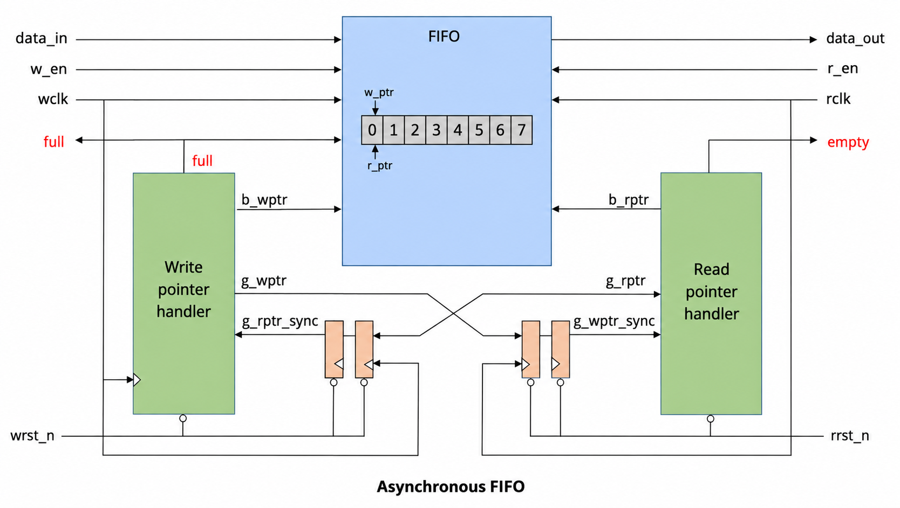
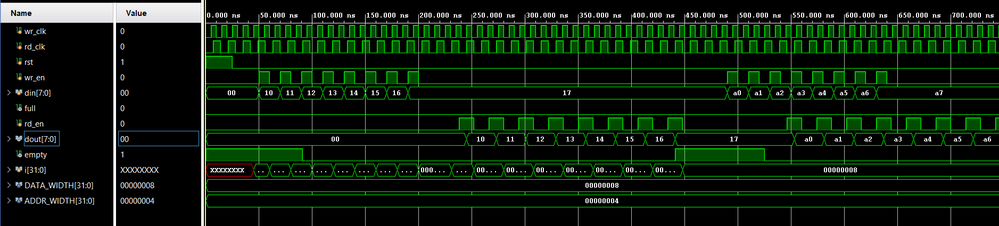

# Asynchronous FIFO

A parameterized **asynchronous FIFO** implemented in Verilog HDL, designed to safely transfer data between two independent clock domains. The design uses separate write and read clocks, Gray-coded pointers, and two-stage pointer synchronizers for clock-domain crossing.

---

## Microarchitecture



---

## Features

- Independent **write and read clock domains**
- Parameterized data width and address width
- Binary write/read pointers
- Binary-to-Gray pointer conversion
- Two-stage clock-domain synchronization of Gray-coded pointers
- `full` and `empty` status generation
- Separate write and read operations
- Asynchronous active-high reset
- Suitable for reliable clock-domain crossing (CDC)

---

## Project Structure

```text
Asynchronous_FIFO/
│
├── architecture/
│   └── async_fifo.png
│
├── rtl/
│   └── async_fifo.v
│
├── simulation/
│   └── async_fifo_tb.v
│
├── waveform/
│   └── waveform.png
│
├── LICENSE
└── README.md
```

---

## FIFO Parameters

The FIFO is parameterized using:

```verilog
parameter DATA_WIDTH = 8;
parameter ADDR_WIDTH = 4;
```

The FIFO depth is derived as:

```text
DEPTH = 2^ADDR_WIDTH
```

With the default parameters:

```text
Data width = 8 bits
Address width = 4 bits
FIFO depth = 16 entries
```

The implementation uses an additional pointer bit so that wrap-around can be distinguished when generating the `full` and `empty` conditions.

---

## Interface

| Signal | Direction | Description |
| ------ | --------- | ----------- |
| `wr_clk` | Input | Write-domain clock |
| `rd_clk` | Input | Read-domain clock |
| `rst` | Input | Asynchronous active-high reset |
| `wr_en` | Input | Write enable |
| `din` | Input | Input data |
| `full` | Output | Indicates that the FIFO cannot accept another write |
| `rd_en` | Input | Read enable |
| `dout` | Output | Output data |
| `empty` | Output | Indicates that the FIFO has no data available to read |

---

## How It Works

An asynchronous FIFO operates with two independent clock domains:

```text
             WRITE DOMAIN                    READ DOMAIN

        wr_clk                              rd_clk
          │                                    │
          ▼                                    ▼
   Write Pointer                          Read Pointer
          │                                    │
          ▼                                    ▼
     Binary → Gray                        Binary → Gray
          │                                    │
          │                                    │
          └─────── CDC Synchronizers ─────────┘
```

The FIFO memory is shared between the two domains, while the write and read control logic remains local to its respective clock domain.

### Write Path

On each rising edge of `wr_clk`:

1. The write enable is checked against `full`.
2. If `wr_en && !full`, `din` is written into the memory location selected by the current write pointer.
3. The binary write pointer advances.
4. The updated binary pointer is converted to Gray code.
5. The `full` status is updated using the synchronized read pointer.

The RTL implements the write condition as:

```verilog
if (wr_en && !full)
    mem[wr_ptr_bin[ADDR_WIDTH-1:0]] <= din;
```

---

### Read Path

On each rising edge of `rd_clk`:

1. The read enable is checked against `empty`.
2. If `rd_en && !empty`, data is read from the memory location selected by the current read pointer.
3. The binary read pointer advances.
4. The updated binary pointer is converted to Gray code.
5. The `empty` status is updated using the synchronized write pointer.

The RTL implements the read condition as:

```verilog
if (rd_en && !empty)
    dout <= mem[rd_ptr_bin[ADDR_WIDTH-1:0]];
```

---

## Binary and Gray-Code Pointers

The write and read pointers are maintained in binary form for memory addressing. Gray-coded versions are generated for clock-domain crossing.

The binary-to-Gray conversion is:

```verilog
gray = (binary >> 1) ^ binary;
```

Gray code is used because only one bit changes between consecutive pointer values, which reduces the risk of multiple-bit sampling errors while crossing between asynchronous clock domains.

The lower pointer bits select the FIFO memory entry, while the additional pointer bit(s) provide wrap-around information for status generation.

---

## Clock-Domain Synchronization

The write-domain logic needs a synchronized version of the read pointer, and the read-domain logic needs a synchronized version of the write pointer.

Two flip-flop stages are used in each direction:

```text
Read Gray Pointer
      │
      ▼
  sync1 register
      │
      ▼
  sync2 register
      │
      ▼
Write-domain logic
```

and:

```text
Write Gray Pointer
      │
      ▼
  sync1 register
      │
      ▼
  sync2 register
      │
      ▼
Read-domain logic
```

This provides the required synchronization boundary between the two asynchronous clock domains.

---

## Empty Detection

The FIFO is empty when the next read pointer is equal to the synchronized write pointer.

The RTL implements:

```verilog
assign empty_next =
        (rd_ptr_gray_next == wr_ptr_gray_sync2);
```

Conceptually:

```text
Next Read Pointer == Synchronized Write Pointer
                     ↓
                   EMPTY
```

This means there is no unread data remaining in the FIFO.

---

## Full Detection

The FIFO is full when the next write pointer reaches the read pointer after a complete FIFO wrap-around.

The RTL compares the next Gray-coded write pointer with the synchronized read pointer after inverting the upper pointer bits:

```verilog
assign full_next =
    (wr_ptr_gray_next ==
    {
        ~rd_ptr_gray_sync2[ADDR_WIDTH:ADDR_WIDTH-1],
         rd_ptr_gray_sync2[ADDR_WIDTH-2:0]
    });
```

Conceptually:

```text
Next Write Pointer == Wrapped Read Pointer
                      ↓
                     FULL
```

The extra pointer information is what allows the design to distinguish an empty FIFO from a FIFO whose pointers have wrapped around to the same memory index.

---

## Reset Behavior

The FIFO uses a common asynchronous active-high reset.

During reset:

```text
Write pointer = 0
Read pointer  = 0
Full          = 0
Empty         = 1
Output data   = 0
Synchronizer registers = 0
```

After reset, the FIFO starts in the empty state and can accept writes immediately once the write-side logic is enabled.

---

## Simulation

The testbench is located at:

```text
simulation/async_fifo_tb.v
```

It generates two independent clocks:

```verilog
wr_clk → 10 ns period
rd_clk → 14 ns period
```

The testbench exercises the FIFO using several scenarios:

### Test 1 — Write

Eight bytes are written into the FIFO:

```text
10, 11, 12, 13, 14, 15, 16, 17
```

### Test 2 — Read

The previously written values are read back after allowing time for pointer synchronization.

### Test 3 — Simultaneous Read/Write

Eight values are written while eight values are read concurrently:

```text
A0, A1, A2, A3, A4, A5, A6, A7
```

The testbench also waits on the `full` and `empty` flags before attempting operations that would otherwise overflow or underflow the FIFO.

---

## Simulation Waveform



The waveform can be used to verify:

- Independent write and read clocks
- Write enable and read enable behavior
- Correct data transfer
- Binary pointer progression
- Gray pointer progression
- Pointer synchronization across clock domains
- `full` assertion and deassertion
- `empty` assertion and deassertion
- Correct output data ordering

---

## Key Design Concepts

### Asynchronous Clocks

The write and read sides do not share a common clock. Data may therefore be written and read at different rates.

### Gray-Code CDC

Binary pointers are converted to Gray code before crossing clock domains. This ensures that only one pointer bit changes for each increment.

### Two-Stage Synchronizers

The Gray-coded pointer from the opposite clock domain passes through two sequential registers before being used by local control logic.

### Local Status Generation

`full` is generated in the write clock domain, while `empty` is generated in the read clock domain. Each side uses a synchronized copy of the opposite pointer.

---

## Advantages

- Safely transfers data between unrelated clock domains
- Prevents FIFO overflow through the `full` flag
- Prevents FIFO underflow through the `empty` flag
- Parameterized and reusable RTL
- Simple, modular Verilog implementation
- Demonstrates practical clock-domain crossing techniques

---

## Design Limitation

The design assumes that the asynchronous FIFO memory can be safely shared between the write and read domains in the target implementation technology. For FPGA or ASIC implementation, the memory structure and CDC constraints should be reviewed for the specific technology and synthesis flow.

---

## References

The architecture follows the standard asynchronous FIFO approach using:

```text
Binary Pointers
      ↓
Gray-Code Conversion
      ↓
Two-Stage CDC Synchronization
      ↓
Local Full / Empty Generation
```

This makes the design a useful reference implementation for studying asynchronous FIFOs and clock-domain crossing techniques in Verilog.
